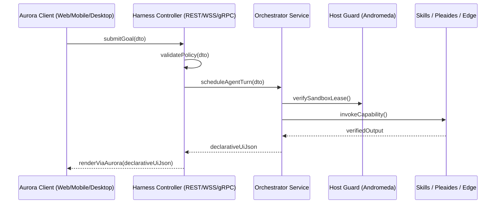

<p align="center"></p>

<h1 align="center">Pulsar</h1>
<p align="center"><strong>Sovereign multi-agent harness with decoupled Linux server core and Aurora native rendering over the declarative protocol</strong></p>

<p align="center">
  
  
  
  
  <a href="LICENSE"></a>
  <a href="https://natuleadan.com"></a>
</p>

## 1. What is Pulsar?

Pulsar is a sovereign, clean-slate pure-Rust multi-agent harness and durable swarm orchestrator. Its **server side** runs primarily on Linux and integrates with Orion API contracts and typed schemas and Andromeda over decoupled network protocols (REST, WebSocket/WSS, gRPC)—never via direct Cargo crate dependencies—while its **client side** uses Aurora over those same wire protocols to auto-generate responsive interfaces across **Web, iOS, Android, macOS, and Windows**. Its modular crate architecture also allows constrained, feature-gated edge profiles for diverse microcontrollers and IoT hardware.

### What is inside

Pulsar implements a layered modular six-file modular monolith (`entity`, `dto`, `repository`, `service`, `controller`, `mod`) inside a pure-Cargo workspace (`crates/core` and `crates/xtask`), verified by eight automated validation gates and a 3-day dependency cooldown.

> **Current scope:** This release ships the native validation harness, the six-file modular reference domain (`modules/math`), and the crate contracts. Transports, sandboxes, domain engines and protocol integrations described below are planned milestones, not shipped capabilities.

## 2. Why Pulsar?

Most agent frameworks wrap fragile Python or Node.js scripts around LLM loops without durable execution, strict sandboxing, or cross-platform client rendering.

- **Decoupled server integration**: Communicates with Orion-based API contracts and Andromeda host daemons strictly over REST, WSS, or gRPC without direct Cargo coupling.
- **Aurora-powered client side**: Agents emit declarative agent-to-UI JSON payloads over wire protocols, rendered automatically by Aurora across Web, iOS, Android, macOS, and Windows.
- **Modular edge-ready design**: Strict layer isolation lets feature-gated profiles run lightweight harness subsets across diverse microcontrollers and IoT devices.
- **Zero formatter drift**: Formatters are excluded from hooks and CI so diffs remain clean and auditable.

## 3. Highlights

- **Multi-agent swarm orchestration**: Coordinate specialized subagents, durable workflows, and reactive wakeups cleanly.
- **Pure Cargo automation via `xtask`**: Native `cargo xtask validate`, `notices`, and `release` subcommands.
- **Eight standardized validation gates**: Full verification across lint, typecheck, unit tests, architecture boundaries, cooldown, hygiene, notices, and releases.
- **Supply-chain hardening**: 3-day dependency publish cooldown (`resolver.min-publish-age="3 days"`), CodeQL, and SBOM artifacts.
- **Apache-2.0 licensed**: Enterprise-friendly licensing with automated `ThirdPartyNotices.txt` verification.

## 4. Quick Start

Ensure Rust `1.85+` (Rust 2024 edition / stable, matching `rust-version = "1.85"`) is installed:

```bash
# Clone the repository
git clone https://github.com/natuleadan/pulsar.git
cd pulsar

# Activate local hooks
git config core.hooksPath .githooks

# Run the complete 8-gate native validation suite
cargo xtask validate
```

Other native `xtask` operations:

```bash
cargo xtask notices          # Regenerate ThirdPartyNotices.txt from cargo metadata
cargo xtask release --check  # Verify Cargo.toml version and CHANGELOG parity
cargo test --workspace       # Execute unit, integration, and architecture tests
```

## 5. Use Cases

- **Autonomous engineering swarms**: Run long-lived coding and operations teams with checkpointed durable state on Linux servers.
- **Multi-platform agent workspaces**: Operate swarms seamlessly from Web, iOS, Android, macOS, and Windows clients via Aurora.
- **Constrained edge & robotic bridges**: Dispatch verified tool and mobility intents over wire protocols to Pleaides and diverse microcontroller/IoT edge nodes.

## 6. How It Works



Operator commands enter through Orion-based network controllers, validate contracts via `dto`, advance durable sessions inside `service` under Andromeda host supervision over wire protocols, and stream declarative UI updates back to Aurora clients.

## 7. Status and Roadmap

- **Status**: Initial foundation — validation harness and modular reference skeleton in place; domain implementation in progress.
- **Milestone 1**: Core durable session store, sandboxed execution, and decoupled REST/WSS/gRPC integration with Orion-based API contracts and Andromeda.
- **Milestone 2**: Aurora declarative client integration across Web, iOS, Android, macOS, and Windows.
- **Milestone 3**: Constrained multi-microcontroller edge profiles and decoupled Pleaides robotics bridge certification.

## 8. Repository Layout & Validation Gates

```text
.
├── .cargo/                  # Cargo configuration and 3-day cooldown resolver
├── .githooks/               # Versioned commit-msg, pre-commit, and pre-push hooks
├── .github/                 # Issue templates, dependabot config, and CI workflows
├── crates/
│   ├── core/                # Core harness library (modules/math reference domain, lib.rs)
│   │   └── tests/           # integration.rs and immutable architecture.rs tripwires
│   └── xtask/               # Pure-Rust automation CLI (cargo xtask <cmd>)
├── .env.example             # Environment contract template (copy to git-ignored .env)
├── Cargo.toml               # Workspace manifest (rust-version = "1.85", [workspace.lints])
├── clippy.toml              # Strict Clippy policy (max-fn-params-bools = 0)
├── ARCHITECTURE.md          # Modular domain architecture specifications
├── AGENTS.md                # Autonomous AI agent operating guidelines
├── CONTRIBUTING.md          # Contribution workflow and commit grammar
├── SECURITY.md              # Supply-chain policies and vulnerability reporting
├── LICENSE                  # Apache-2.0 License
├── NOTICE                   # Copyright (c) 2026 Natuleadan.
└── ThirdPartyNotices.txt    # Automated third-party license inventory
```

| Gate | Command | Purpose |
| :--- | :--- | :--- |
| `lint` | `cargo clippy --workspace --all-targets --all-features -- -D warnings` + `cargo doc -D warnings` | Strict zero-warning static analysis and rustdoc checks |
| `typecheck` | `cargo check --workspace --all-targets` | Workspace type verification |
| `unit tests` | `cargo test --workspace --lib` + `--doc` | Library unit tests and runnable doc examples |
| `integration and architecture tests` | `cargo test --workspace --test '*'` | Integration flows and layer tripwires |
| `cooldown` | `cargo --config 'resolver.min-publish-age="3 days"'` | 3-day package release cooldown |
| `hygiene` | `crates/xtask/src/hygiene.rs` | 500-line limit, anti-leak, and syntax checks |
| `notices` | `crates/xtask/src/notices.rs` | License inventory parity check |
| `release` | `crates/xtask/src/release.rs` | SemVer and CHANGELOG consistency |

## 9. Documentation

- [ARCHITECTURE.md](ARCHITECTURE.md): Modular architecture, layer boundaries, and design invariants.
- [CONTRIBUTING.md](CONTRIBUTING.md): Issue-first contribution policy, PR workflow, and commit grammar.
- [SECURITY.md](SECURITY.md): Vulnerability disclosure procedures and supply-chain controls.
- [AGENTS.md](AGENTS.md): Machine-facing instructions for autonomous engineering.

## 10. Ecosystem & Community

Pulsar is the central orchestrator of the Natuleadan constellation, communicating strictly over decoupled wire protocols (REST, WSS, gRPC) with Orion, Andromeda, Aurora, Pleaides, Caelum, Lyra, and Skills.

<p align="left">
  <a href="https://github.com/natuleadan"></a>
  <a href="https://github.com/leojara95"></a>
</p>

Bug reports and feature proposals are tracked via structured GitHub Issues.

## 11. Contributing

External pull requests are restricted to maintainers (`collaborators_only`). Please open an issue describing your bug or proposal. See [CONTRIBUTING.md](CONTRIBUTING.md) for details.

## 12. License & Star History

This project is licensed under the Apache License 2.0. Copyright (c) 2026 Natuleadan.

Terms are in [LICENSE](LICENSE), attribution in [NOTICE](NOTICE), and third-party dependency notices in [ThirdPartyNotices.txt](ThirdPartyNotices.txt).

<a href="https://www.star-history.com/#natuleadan/pulsar&Date">
  <picture>
    <source media="(prefers-color-scheme: dark)" srcset="https://api.star-history.com/image?repos=natuleadan/pulsar&type=date&theme=dark" />
    <source media="(prefers-color-scheme: light)" srcset="https://api.star-history.com/image?repos=natuleadan/pulsar&type=date&theme=light" />
    
  </picture>
</a>
